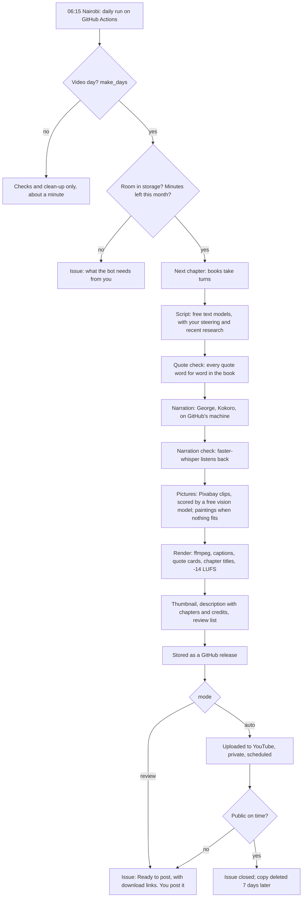

# How it works: from a book chapter to a YouTube video

The bot is a chain of small steps. Each step uses a free service or a model that runs on GitHub's own machine,
checks its work, and has a fallback if something is busy or down. Nothing in the chain costs money.

## The steps, and which AI does each

| # | Step | Done by | Free because | If it fails |
|---|---|---|---|---|
| 1 | **Decide what to do** (`owd plan`, `owd cleanup`) | Plain code | Runs on GitHub's free minutes | A "needs attention" issue |
| 2 | **Pick the chapter** | Plain code: the book with the fewest videos goes next (`book_order`) | — | No chapters left: an issue asks for a book |
| 3 | **Gather research** | Plain code reads 5 science feeds (ScienceDaily, PsyPost, Greater Good, Psyche, Aeon), politely | Public feeds | Written without research |
| 4 | **Write the script** | Free text models through **OpenRouter** (Nemotron, Gemma, dots), then **Gemini**, then **Cloudflare**, in the order in `channel.toml` `[llm]` | Free tiers | The next model is tried; if all are busy, the run fails and the next video day tries again |
| 5 | **Check the quotes** | Plain code: every quote must be in the book word for word | — | The run stops (no misquotes, ever) |
| 6 | **Narrate** | **Kokoro-82M** (voice `bm_george`), on GitHub's machine | Open model, Apache-2.0, pinned version | The run fails |
| 7 | **Check the narration** | **faster-whisper** (base.en) transcribes George and compares with the script | Open model, on the machine | Differences are listed in the review |
| 8 | **Find footage** | **Pixabay** search (the scene's own search words) | Free API, credited | Fallback searches from `channel.toml` |
| 9 | **Match pictures to the words** | **Gemini Flash-Lite** (vision) looks at 4 candidate stills next to George's sentence and scores each 0 to 10 | Free tier | A busy model is retried, then the other model; answers are cached; otherwise the best tag match is used and flagged |
| 10 | **Paint what footage can't show** | **Cloudflare Workers AI, FLUX.2 [klein]**, from the scene's painting description | 10,000 free units a day (about 40 paintings) | The closest clip is used and flagged |
| 11 | **Render** | **ffmpeg**: shots, crossfades, chapter titles, quote cards, burned-in captions, loudness -14 LUFS | Open source | Lengths are checked before the final encode; a drifting video stops the run |
| 12 | **Thumbnail, description, review list** | Plain code (Anton font) | — | — |
| 13 | **Store** | A **GitHub release** in this repository | Free, no size limit (files under 2 GiB) | The run fails and the chapter is made again |
| 14 | **Deliver** | Review mode: an issue. Auto mode: the **YouTube Data API** uploads it, private, scheduled | Free quota (10,000 units a day) | The copy comes to you as "Ready to post", with the reason |
| 15 | **Check and clean up** | Plain code, every day | — | A failed deletion is retried the next day |

## How the script is written

1. The chapter is sent as numbered sentences (S1, S2, ...), with your instructions (`steering/instructions.md`),
   your documents (`steering/references/`), the guardrails and up to 12 recent research stories.
2. The model answers in a fixed shape: title, chapters, scenes (each with words, a footage search and a painting
   description), quotes **by sentence number**, an open question for the hook, `[pause]` beats, and every
   factual claim with its source.
3. The bot inserts the book's exact words for each quote, so a model can't misquote it.
4. Checks: shape (rejected and retried), length, chapters, quotes, pauses, title length. Short drafts are
   expanded one chapter at a time. Research ids are removed from the narration.

## How a video goes on YouTube

- **Review mode** (now): the bot never touches YouTube. You download the stored copy from the issue, upload it
  in YouTube Studio (title, description, thumbnail, captions file, "altered or synthetic content": yes) and
  close the issue.
- **Auto mode** (after `docs/DEPLOY.md` step 4): the bot uploads the video as **private** with a publish time
  (`publish_days`, `publish_time`), marks it as containing synthetic media, sets the category to Education,
  adds the thumbnail and captions, and opens a "Scheduled" issue. Half an hour after the publish time it checks
  the video is public. If YouTube kept it private or refused it, the issue switches to "Ready to post" with the
  stored copy and the fix.

## What runs where

| Where | What |
|---|---|
| GitHub Actions (free minutes) | Everything above, on a 2-core Linux machine, once a day |
| Free services called over the internet | OpenRouter, Gemini, Cloudflare Workers AI, Pixabay, Project Gutenberg's mirror, YouTube |
| GitHub itself | Code, settings, state (`state/`), stored videos (releases), messages to you (issues), the control panel's data |
| Your browser | The control panel (`panel/`), talking only to GitHub |

The keys each service needs, and what each one can do: `docs/KEYS.md`.
